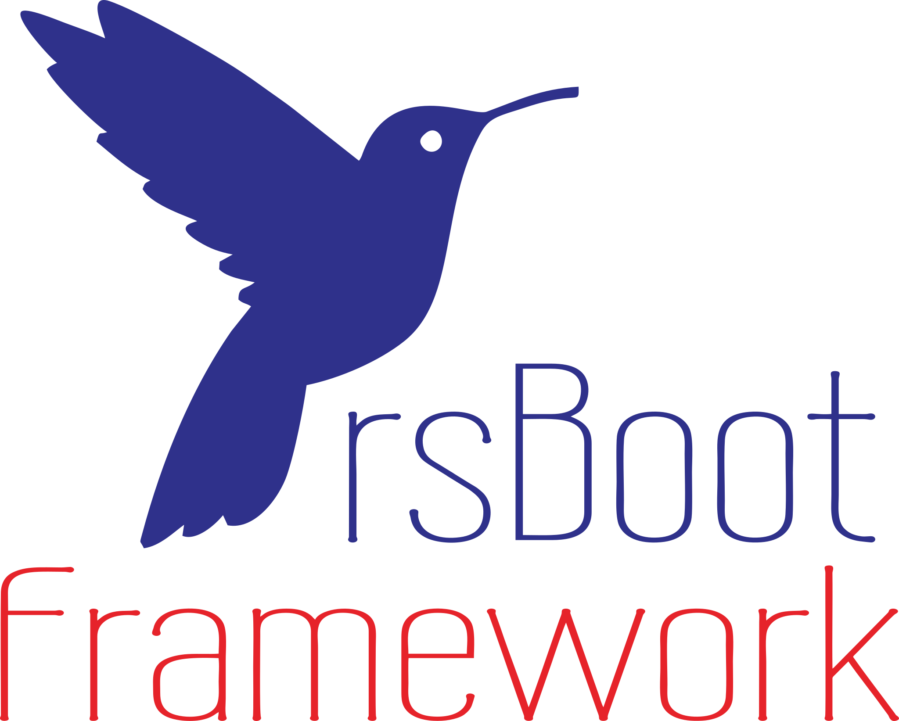

<p align="center">
  
</p>

# rsboot

> ### Der schnellste Weg, einen Rust-Webdienst zu *bauen*.
>
> Bei I/O-lastiger Last schneller als axum und actix-web — **9 687 QPS** bei 200 gleichzeitigen Clients / 20 ms, **96-fach gegenüber der eigenen synchronen Vorgängerversion**. Eine Abhängigkeitszeile in `Cargo.toml`; Signalbehandlung, OpenAPI-Dokumentation und Connection-Pooling sind eingebaut — in wenigen Zeilen vom leeren Verzeichnis zum laufenden Endpunkt.
>
> Wir sind **nicht** der Meister im reinen Durchsatz, und dieses README tut nicht so: Auf dem JSON-Pfad ohne I/O liegt actix-web bei vier Workern auf beiden Seiten und 16-fach gepipelineten Clients rund 3 % vorn. Die Tabelle unten zeigt jede Spalte — auch die, in denen wir verlieren.

Ein im Rust-Ökosystem beheimatetes Anwendungsframework — deklaratives Routing im FastAPI-Stil, typisierte Extraktion, automatisch erzeugte OpenAPI-Dokumentation. **Synchrone Handler laufen auf Stackful-Coroutinen über nicht blockierenden Sockets**: langsame I/O gibt den Worker frei, statt ihn zu belegen. HTTP/1.1-Stack, Scheduler und Event-Loop sind vollständig selbst geschrieben — kein tokio, kein hyper, kein axum.

[English](README.md) · [中文](README.zh-CN.md) · [Deutsch](README.de.md) · [Français](README.fr.md) · [العربية](README.ar.md) · [Русский](README.ru.md)

**Status: Alpha (`0.1.0-alpha.1`).** Die Kernkette — HTTP, Routing, Extraktoren, einheitliche Antwort-Hülle, einheitliche Fehlerbehandlung, OpenAPI, Modul-Lebenszyklus, kontrolliertes Herunterfahren, Coroutine-Scheduling, Datenbank-Sockets — ist implementiert und durch Tests abgedeckt. WebSocket / JSON-RPC fehlen noch; siehe [Bekannte Einschränkungen](#bekannte-einschränkungen).

`rsboot` ist das Anwendungsframework, [rsbatis](https://github.com/pengdeyou/rsbatis) ist das ORM. Getrennte Crates, getrennte Repositories, unabhängige Versionen.

## Warum es das gibt

Der Reiz von FastAPI lässt sich auf drei Punkte reduzieren: deklarative Routen, Typen als Validierung, kostenlos erzeugte Dokumentation. Den gängigen Rust-Frameworks fehlt jeweils einer davon:

| | Handler | Preis |
|---|---|---|
| axum / actix-web | `async fn` | `Send + 'static`-Bounds; `&Request` lässt sich nicht über einen await-Punkt hinweg ausleihen; asynchrone DB-/HTTP-Clients ziehen tokio + hyper + sqlx in den Abhängigkeitsbaum |
| Rein synchrone Frameworks | `fn` | Die Worker-Anzahl entspricht der Kernanzahl, der Durchsatz ist also auf *Worker ÷ Blockierdauer* begrenzt — eine langsame Abhängigkeit legt den ganzen Server lahm |

Die zweite Zeile ist gemessen, nicht behauptet: bei 20 ms Downstream-Latenz und 200 gleichzeitigen Clients lieferte eine rein synchrone Implementierung **99 QPS**. Beide Worker warteten schlicht.

rsboot teilt das Problem in zwei Schichten: **die Verbindungsschicht ist ereignisgetrieben, die Anfrageschicht läuft auf stackbasierten Coroutinen.** Handler behalten eine gewöhnliche synchrone Signatur; langsame I/O gibt den Worker frei, statt ihn zu belegen.

## Leistungsvergleich

Gemessen gegen axum und actix-web. Alle Server laufen im selben Zeitfenster, abwechselnd, mit identischen Routen; angegeben sind QPS. **Zahlen aus verschiedenen Fenstern sind nicht vergleichbar** — das Protokoll hat sich geändert, die älteren Zeilen bleiben nur, weil sie die einzige Messung dieser Last sind.

### Wie die aktuellen Zahlen entstehen

- 4-Kern-Linux-Maschine, **4 Worker-Threads auf allen Servern**, Client mit **4 Threads**, 1 000 Keep-Alive-Verbindungen, `pipeline 16`.
- Jede Konfiguration läuft **10 Runden × 8 s**, A/B rundenweise abwechselnd; danach eine zweite Charge mit umgekehrter Reihenfolge. Die 20 Runden werden gepoolt: Mittelwert plus Sieg/Niederlage-Verteilung.
- Das Rauschen zwischen den Runden liegt auf dieser Maschine bei **±0,35 %**, mit einem Split von 10:10 bis 13:7. Alles Kleinere ist kein Ergebnis, und beide Chargen müssen in dieselbe Richtung zeigen.
- Aktueller Stand gegen actix-web 4 (gleiches Fenster, beide mit 4 Workern): rsboot **999 411** vs. actix **1 033 174** — **−3,3 %**, 1:19.

Das vollständige Protokoll — jede Änderung, ihr Delta und alles, was gemessen und wieder verworfen wurde — steht in [docs/perf-log.md](docs/perf-log.md).

Die Zeilen `/slow` und `/json` unten stammen aus einem **früheren Fenster** (4-Kern-VM, überall 2 Worker-Threads, kürzere Läufe).

| Szenario | rsboot | axum | actix-web |
|---|---:|---:|---:|
| `/slow` — 20 ms Verzögerung, 5 gleichzeitig | **248** | 236 | 236 |
| `/slow` — 20 ms Verzögerung, 20 gleichzeitig | **990** | 944 | 944 |
| `/slow` — 20 ms Verzögerung, 200 gleichzeitig | **9 687** | 9 237 | 9 292 |
| `/json` — 4 gleichzeitig, no blocking I/O | **112 267** | 92 280 | 110 919 |
| `/json` — 20 gleichzeitig, no blocking I/O | 131 350 | 133 843 | **155 315** |

Was die Tabelle aussagt — einschließlich dessen, was uns nicht schmeichelt:

- Bei blockierenden Lasten ist rsboot der schnellste der drei, aber nur um wenige Prozent gegenüber axum/actix — alle drei halten die Worker beschäftigt und konvergieren daher. Die eigentlich interessante Zahl ist der Vergleich mit **unserer eigenen synchronen Version**: 99 → 9 687 QPS bei 200 gleichzeitigen Clients, **96-fach**. Genau dafür existiert die Coroutine-Schicht.
- Der reine JSON-Durchsatz spaltet sich nach Nebenläufigkeit, und wir verlieren eine Hälfte davon. Bei 4 Clients führt rsboot (**112 267** — 1,2 % vor actix, 21,7 % vor axum). Bei 20 Clients **zieht actix-web um 18 % davon** (155 315 gegenüber 131 350) und axum überholt uns knapp um 1,9 %. Die gemessene Ursache ist unsere Header-State-Machine (757 ns pro Request-Head gegenüber 122 ns bei `httparse`) plus Buchhaltung pro Anfrage — Kosten, die mit gleichzeitigen Anfragen wachsen. Ebenfalls verifiziert: woran es *nicht* liegt — `poll`-Blockieren macht nur 14 % der Worker-Zeit aus, und kleine Antworten gehen bereits in einem einzigen `write` raus.
- Die frühere Zahl 157 730 ist **zurückgezogen**. Der Lastgenerator selbst kostete Mikrosekunden pro Anfrage (zwei `Instant::now()`-Aufrufe zu je ~1,8 µs auf dieser Test-VM), was alle drei Server auf denselben Wert plättete. Die Tabelle stammt aus einem neu gebauten Client: `rdtsc`-Zeitmessung, keine Allokation und kein Syscall pro Anfrage.
- Downstream-Aufrufe: 40 gleichzeitige Clients × 20 ms Abhängigkeit, kooperativer Modus **655 QPS / p99 62 ms** gegenüber blockierender Basis **33 QPS / p99 2 323 ms** — 20-facher Unterschied, ausgelöst durch einen einzigen Schalter (`RSBOOT_BLOCKING_IO`).

Diese Zahlen schwanken je nach Maschine. Vergleiche nur innerhalb eines Laufs, nie über Maschinen hinweg und nie gegen absolute Werte aus fremden Blogposts.

### Gemessen und verworfen

Hier festgehalten, damit niemand denselben Versuch noch einmal mit der Erwartung auf einen Gewinn fährt. Protokoll wie oben; ein negatives Delta heißt **langsamer**.

| Änderung | Ergebnis | Warum es nichts brachte |
|---|---|---|
| Namensfeld in einem Durchlauf (Doppelpunkt + trailing OWS + Token-Prüfung) | −0,06 %, 13:7 | Neutral. Die Parse-Zeit liegt nicht darin, „wie oft wir die Bytes durchlaufen" |
| `Hdr` 64 → 32 Bytes (Offset-Tabelle + Seitentabelle) | −0,59 %, 9:11, Chargen widersprüchlich | eine Indirektion mehr bei jedem Header-Zugriff |
| `get_unchecked` in den Parse-Schleifen | **−1,69 %**, 14:6 | Grenzprüfungen waren schon gratis; `unsafe` blockierte andere Optimierungen |
| CRLF-Scan im Response-Head von Hand | −1,36 %, 12:8 | `str::contains` nutzt vektorisiertes memchr |
| `from_utf8_unchecked` auf dem Header-Slice | −0,99 %, 12:8 | gleiche Begründung — die Prüfung ist nicht der Aufwand |
| Thread-lokaler Pool für Response-Header-`Vec`s | −0,35 %, 12:8 | und `Drop` auf `Headers` bricht das Borrowing in `serve_once` |
| `-C target-cpu=x86-64-v3` / `native` | +0,9 %, aber AB −0,4 % / BA +2,3 % | gegenläufige Chargen = Rauschen |
| 12 Header-Slots inline, um ein `malloc` zu sparen | −8,3 % | das memset über 12 × 64 Bytes kostet mehr als die Allokation |
| Alle Antworten in `out_buf` sammeln (Direkt-Schreibpfad entfernt) | −4,3 % | ein pipelinender Client hält Anfragen in Flight, der Server sieht selten mehr als eine |
| `SO_REUSEPORT`, Accept pro Worker | keine Änderung | der Accept-Thread wacht im Steady State alle 5 ms auf |
| Kleinere `SO_SNDBUF` / `SO_RCVBUF` | −0,04 % | im Rauschen |
| 4 KiB Lesepuffer als Standard | +0,8 %, nicht signifikant | 1 KiB fasst bereits ~12 Request-Heads |
| Eingebauter tcache-Allocator (Feature `tc-alloc`) | +0,36 % | Obergrenze ~0,5 %, standardmäßig aus |

Für alle, die die restlichen 3 % angreifen wollen: im Profil sind zwei Syscalls 70 % einer Anfrage (3,5–4 µs von 5 µs), Userland ist ~1 µs (`parse` 275 ns, `build` 145, `handle` 555). Die Lücke beträgt also ~150 ns und kann nur in diesen drei Stufen liegen — drei strukturelle Versuche an `parse` landeten jedoch alle im Rauschen, was heißt: die 275 ns sind feste Arbeit pro Anfrage (Item-Aufbau, `Vec`-Buchhaltung, Span-Einträge, Abschlussvalidierung), nicht die Scanbreite. Der nächste ehrliche Schritt ist, `handle` selbst mit 1/64-Sampling zu instrumentieren und die 555 ns in Routing, Kontext, User-Handler und Response-Aufbau zu zerlegen.

## Entwurfsmerkmale

1. **Keine Laufzeitumgebung von Drittanbietern.** HTTP/1.1-Parsing, Keep-Alive-Verwaltung, `writev`-Batching, Poll-Schleife und M:N-Scheduler liegen alle im Repository. Die Abhängigkeitsebene ist serde, nicht tokio. Weniger bewegliche Teile — und keine Versionsbindung an Interna einer Async-Runtime.

2. **Handler bleiben synchron und blockieren den Server trotzdem nicht.** Ein Handler ist `fn(&mut Request, &Context) -> Result<Response, ApiError>`. Stackbasierte Coroutinen halten den Zustand auf einem echten Stack, deshalb lässt sich `&mut Request` über einen Yield-Punkt hinweg halten — etwas, das eine compilererzeugte Zustandsmaschine ohne akrobatische Lifetimes nicht ausdrücken kann.

3. **Zwei Schichten, bewusst getrennt.** Verbindungen werden vom Event-Loop gemultiplext, Anfragen laufen als Coroutinen. Die Coroutine-Anzahl folgt den **laufenden Anfragen**, nicht den offenen Verbindungen — eine Keep-Alive-Verbindung kostet daher wenige Bytes statt eines 64-KB-Stacks.

4. **Datenbank-Sockets geben den Worker frei.** `mysql+co://…` leitet den MySQL-Treiber über coroutine-fähige Sockets: Eine langsame Abfrage parkt die Anfrage, statt einen Worker zu blockieren. Der Hook ist prozessweit, der Modus thread-lokal — zwei Engines im selben Prozess können sich nicht gegenseitig verunreinigen.

5. **Auch Downstream-Aufrufe geben frei.** `ctx.service("name")` liefert Pool, Retry und Circuit Breaker; das Socket-Lesen ist coroutine-fähig, eine langsame Abhängigkeit beeinträchtigt also einen Endpunkt statt des ganzen Servers.

6. **Eine Antwort-Hülle, ein Fehlertyp.** `Api(...)` verpackt Erfolg und Fehler in dieselbe Form; `ApiError` ist der einzige Fehlertyp, den ein Handler zurückgibt, und er besitzt die Statuscode-Zuordnung. SQL-Text und interne Pfade gehen ins Log, nie an den Client.

7. **Sicherheit scheitert beim Start, nicht im Betrieb.** Eine fehlerhafte CORS-Konfiguration verhindert den Start, statt stillschweigend alles zu erlauben. Token-Bucket-Ratenbegrenzung, Security-Header und Maskierung von Passwörtern in Verbindungsstrings sind eingebaut.

8. **Lebenszyklus und kontrolliertes Herunterfahren sind erstklassig.** Module implementieren `init / start / stop / drain` und werden in umgekehrter Reihenfolge geschlossen. Bei SIGTERM geht der Server in eine Drain-Phase (`http.drain_secs`); `/ready` liefert dann 503, damit der Load Balancer den Verkehr abzieht, *bevor* Verbindungen hart gekappt werden; neue Anfragen während des Schließens bekommen 503 statt eines Verbindungsabbruchs.

9. **OpenAPI wächst mit, statt nachträglich angeflanscht zu werden.** `RouteDoc` hängt an der Routendefinition; `/openapi.json` und `/docs` entstehen aus derselben Quelle der Wahrheit wie die Handler.

10. **Geschichtete Konfiguration, dev/prod-Trennung, Hot Reload.** Schichten aus YAML / ini / env, `app.env` schaltet das Verhalten um, ein Datei-Watcher lädt Änderungen ohne Neustart.

## Schnellstart

```bash
cargo run --example hello
curl -i http://127.0.0.1:8000/api/hello/rsboot
```

Minimalform:

```rust
use rsboot::{ApiError, App, Config, FromRequest, Path, Response, Router};

fn main() -> rsboot::Result<()> {
    let config = Config::new()
        .set("app.env", "dev")
        .set("http.bind", "127.0.0.1:8000")
        .set("http.docs", "true");

    let mut app = App::builder()
        .config(config)
        .database("default", "sqlite:///hello.db")
        .build()?;

    let router = Router::new()
        .get("/", |_, _| Response::text("rsboot is running\n"))?
        .get("/api/hello/{name}", |req, _| -> Result<String, ApiError> {
            let Path(name) = Path::<String>::from_request(req)?;
            Ok(format!("hello, {name}"))
        })?;

    app.serve(router)
}
```

`serve` installiert die Signalbehandlung selbst: Annahme stoppen, Worker auslaufen lassen, Module in umgekehrter Reihenfolge schließen. Keine zusätzliche Verdrahtung nötig.

## Bekannte Einschränkungen

Klar benannt, denn ein Framework, das seine Lücken verbirgt, ist schlechter als eines, das sie auflistet:

- WebSocket und JSON-RPC 2.0 sind noch nicht implementiert (geplant als S12–S13)
- gRPC ist bewusst außerhalb des Umfangs: Es benötigt HTTP/2, was `h2` in den Baum zieht und die Behauptung „keine Laufzeitabhängigkeiten“ aufgibt
- Authentifizierung endet bei den Extraktoren `Bearer` / `ApiKey` — ein vollständiges Rollen- und Rechte-System fehlt
- Coroutine-Stacks sind fest 64 KB, 10 000 gleichzeitige Anfragen kosten also rund 640 MB Stack-Speicher
- Das **Verbinden** auf Client-Seite blockiert weiterhin; erst Lesen/Schreiben nach dem Verbindungsaufbau gibt frei
- Das Lesen von Anfrage-Headern und -Bodies auf dem Hauptpfad kann einen Worker noch blockieren

## Roadmap

Alle nächsten Schritte — P0 (die restlichen 3,3 % gegenüber actix-web),
P1 (Stabilität), P2 (neue Crates), plus die Liste der gemessen und verworfenen
Experimente — stehen in [`docs/ROADMAP.md`](docs/ROADMAP.md).

## Lizenz

MIT OR Apache-2.0, nach Wahl.
